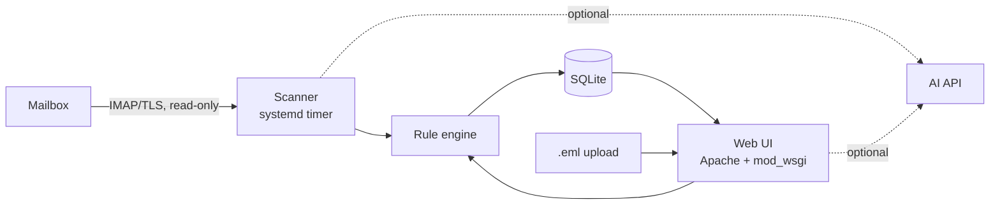

# phishlens

[](https://github.com/aelof1/phishlens/actions/workflows/tests.yml)


**Self-hosted phishing email analyzer**: command line, web interface, read-only IMAP connector and optional AI second opinion.

It checks headers, links and attachments, then gives an explainable risk score out of 100. It never opens a link.


## Features

- **Explainable scoring**: every point comes with the rule that triggered it
- **Command line**: works fully offline, with JSON output for scripts
- **Web interface**: upload or paste an email, from a computer or a phone
- **Mailbox connector**: IMAP over TLS, read-only, scans every 5 minutes
- **Optional AI opinion**: any OpenAI-compatible API, for example a local Ollama; it never changes the score
- **No third-party Python packages** at runtime

## Architecture



## Deploy the web app

Debian or Ubuntu, on premises or in a private cloud network:

```bash
git clone https://github.com/aelof1/phishlens.git
cd phishlens
sudo ./deploy/install.sh
```

Configuration, network rules and security notes: [web/README.md](web/README.md).

> **Project status:** early version. Automated tests run on Linux and Windows. Test the Apache deployment on your own server before relying on it. The command line is offline; the mailbox connector and the AI option use the network.

## Why I built this

When a dodgy email comes in, I always do the same checks by hand: look at SPF/DKIM/DMARC, compare `From` and `Reply-To`, hover over the links, check the attachment extensions. I wanted to automate those steps and understand how an email works "from the inside".

## What it checks

| Category | Checks |
|---|---|
| Authentication | SPF, DKIM and DMARC results (`Authentication-Results` header) |
| Headers | `Reply-To` or `Return-Path` on a different domain than `From`, fake address hidden in the display name |
| Content | Pressure wording ("urgent", "account suspended"…), HTML form inside the email |
| Links | Link to a raw IP address, URL shortener (bit.ly…), punycode domain, frequently abused TLD, link text different from the real destination |
| Attachments | Dangerous extension (`.exe`, `.js`, `.iso`, `.docm`…), double extension (`invoice.pdf.exe`), SHA-256 hash |

Each problem adds points. Final verdict:

- **0 to 29**: PROBABLY SAFE
- **30 to 59**: SUSPICIOUS
- **60 and above**: PHISHING

## Command line compatibility

| System | Works? |
|---|---|
| Linux (Ubuntu, Debian, Kali, Fedora, Arch…) | Yes |
| macOS | Yes |
| Windows 10 / 11 | Yes |

## Requirements

- **Python 3.10 or newer**
- No external libraries: Python standard library only.
- `pytest` only if you want to run the tests.

## Installation

### Linux (Debian, Ubuntu, Kali)

```bash
sudo apt update
sudo apt install -y python3 python3-pip python3-venv pipx git
git clone https://github.com/aelof1/phishlens.git
cd phishlens
pipx install .
```

### Linux (Fedora)

```bash
sudo dnf install -y python3 python3-pip pipx git
```

Then the same `git clone` and `pipx install .` commands.

### Linux (Arch)

```bash
sudo pacman -S python python-pipx git
```

### macOS

```bash
brew install python pipx git
```

### Windows

1. Install Python from [python.org](https://www.python.org/downloads/) and tick **"Add python.exe to PATH"**.
2. In PowerShell:

```powershell
git clone https://github.com/aelof1/phishlens.git
cd phishlens
pip install .
```

### Without installing

From the project folder:

```bash
python3 -m phishlens samples/phishing.eml
```

## Usage

```bash
phishlens mail.eml                 # readable report
phishlens mail1.eml mail2.eml      # several files
phishlens mail.eml --json          # JSON output (for a script or a SIEM)
```

Exit code: `0` if the email looks safe, `1` if it is suspicious or malicious. Handy in scripts.

> **How do I get an `.eml` file?** Gmail: three dots → "Download message". Outlook: drag the email to the desktop, or "Save as". Thunderbird: "Save as".

### Example

```
$ phishlens samples/phishing.eml

=== samples/phishing.eml ===
Subject    : URGENT: Your account has been suspended
From       : "PayPal Security service@paypal.com" <security@paypa1-support.xyz>
Reply-To   : help@secure-verify-account.top
Auth       : SPF=fail  DKIM=none  DMARC=fail
...
Findings:
   [+30] link       Link text shows www.paypal.com but really goes to 185.220.101.4
   [+30] attachment Double extension: Invoice_2026.pdf.exe
   [+20] auth       DMARC = fail
   [+20] headers    Reply-To domain (secure-verify-account.top) differs from From (paypa1-support.xyz)
   ...
Score: 100/100  ->  PHISHING
```

The `samples/` folder contains a fake phishing email and a real legitimate email for testing.

## Project layout

```
phishlens/
├── phishlens/
│   ├── analyzer.py   # all the analysis logic
│   ├── cli.py        # command line
│   ├── imap.py       # mailbox connector
│   ├── ai.py         # optional AI opinion
│   └── store.py      # SQLite results
├── web/              # web interface and Apache configuration
├── deploy/           # installer and systemd units
├── samples/          # example emails
└── tests/            # pytest tests
```

## Tests

```bash
pip install pytest
python3 -m pytest
```

## Limitations

- The tool trusts the `Authentication-Results` header written by the receiving mail server. It doesn't redo the DNS checks itself.
- Domain comparison is simple (last two labels of the name), so it can be wrong for domains like `.co.uk`.
- A low score doesn't guarantee an email is safe. It's a helper, not an antivirus.

## Ideas for later

- DNS lookup of SPF/DMARC records with `dnspython`
- Send attachment hashes to VirusTotal (`--online` option)
- Detect domains imitating a brand (`paypa1`, `rnicrosoft`…)

## Security

See [SECURITY.md](SECURITY.md).

## License

[MIT](LICENSE)
