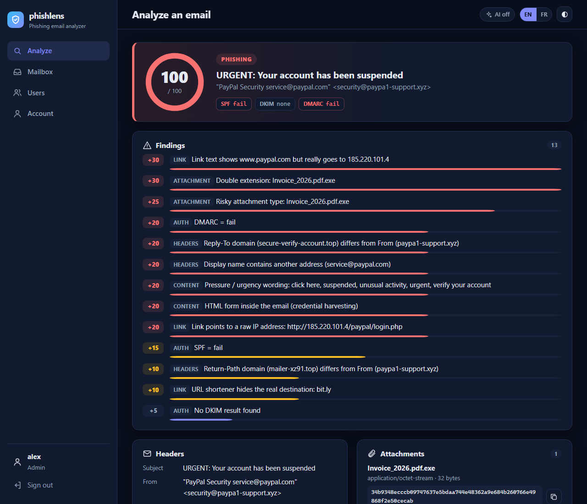
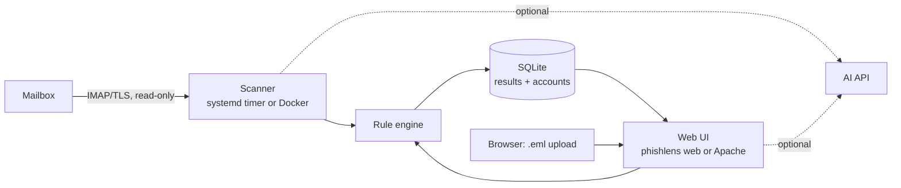
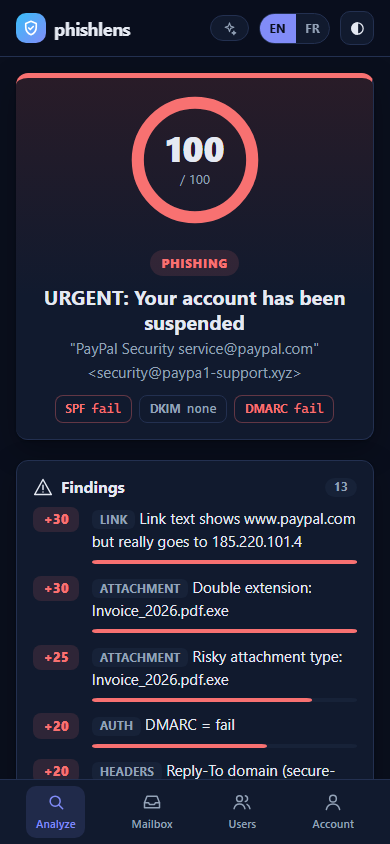

# phishlens

[](https://github.com/aelof1/phishlens/actions/workflows/tests.yml)


**Self-hosted phishing email analyzer**: command line, web interface with user accounts, read-only IMAP connector and optional AI second opinion.

It checks headers, links and attachments, then gives an explainable risk score out of 100. It never opens a link.



## Features

- **Explainable scoring**: every point comes with the rule that triggered it
- **Command line**: works fully offline, with JSON output for scripts
- **Web interface**: drag and drop or paste an email, from a computer or a phone, in English or French, light or dark theme
- **User accounts**: the first admin is created on first start; admins can add viewers
- **Mailbox connector**: IMAP over TLS, read-only, scans every 5 minutes
- **Optional AI opinion**: set up from the web interface with Ollama (local), OpenAI, Claude, Mistral, Groq or any OpenAI-compatible API; it never changes the score
- **Docker**: one `docker compose up -d` for a homelab, with optional mailbox scanner and local Ollama
- **No third-party Python packages** at runtime, no CDN: works offline

## Quick start

| I want to… | Command |
|---|---|
| Analyze a file in a terminal | `phishlens mail.eml` |
| Use the web interface on my computer (Windows, macOS, Linux) | `phishlens web`, then open http://127.0.0.1:8000 |
| Run it in my homelab | `docker compose up -d`: see [Docker](#docker) |
| Install it on a Debian / Ubuntu server with Apache | [Deploy on a server](#deploy-on-a-server) |

Install first (except for Docker): see [Installation](#installation).

## Architecture



## What it checks

| Category | Checks |
|---|---|
| Authentication | SPF, DKIM and DMARC results (`Authentication-Results` header) |
| Headers | `Reply-To` or `Return-Path` on a different domain than `From`, fake address hidden in the display name |
| Content | Pressure wording ("urgent", "account suspended"…), HTML form inside the email |
| Links | Link to a raw IP address, URL shortener (bit.ly…), punycode domain, frequently abused TLD, link text different from the real destination |
| Attachments | Dangerous extension (`.exe`, `.js`, `.iso`, `.docm`…), double extension (`invoice.pdf.exe`), SHA-256 hash |

Each problem adds points. Final verdict:

- **0 to 29**: PROBABLY SAFE
- **30 to 59**: SUSPICIOUS
- **60 and above**: PHISHING

## Compatibility

| | Linux | macOS | Windows 10 / 11 |
|---|---|---|---|
| Command line | Yes | Yes | Yes |
| Web interface (`phishlens web`) | Yes | Yes | Yes |
| Docker (web + scheduled mailbox scan) | Yes | Docker Desktop | Docker Desktop |
| Server deployment (Apache + systemd scan) | Debian / Ubuntu | No | No |

## Requirements

- **Python 3.10 or newer**
- No external libraries: Python standard library only.
- `pytest` only if you want to run the tests.

## Installation

### Windows

1. Install Python from [python.org](https://www.python.org/downloads/) and tick **"Add python.exe to PATH"**.
2. Download the project (or `git clone https://github.com/aelof1/phishlens.git`).
3. Open PowerShell **in the project folder**, the one that contains `pyproject.toml` (not the inner `phishlens\` folder):

```powershell
cd C:\path\to\phishlens
pip install .
phishlens --version
```

On Windows the command is `python`, not `python3`.

**"phishlens is not recognized"?** pip printed `Defaulting to user installation` and put the command in a folder that is not in your `PATH`. Add it once, then **close and reopen** the terminal (and VS Code):

```powershell
$scripts = python -c "import sysconfig; print(sysconfig.get_path('scripts', 'nt_user'))"
[Environment]::SetEnvironmentVariable("Path", [Environment]::GetEnvironmentVariable("Path", "User") + ";$scripts", "User")
```

Or skip the command and use `python -m phishlens` instead of `phishlens` everywhere: it always works.

**"Failed to resolve 'pypi.org'"?** pip could not download its build tool. Check your connection, VPN or proxy, or build with the `setuptools` already installed on your machine: `pip install --no-build-isolation .`

### Linux (Debian, Ubuntu, Kali)

```bash
sudo apt update
sudo apt install -y python3 python3-pip python3-venv pipx git
git clone https://github.com/aelof1/phishlens.git
cd phishlens
pipx install .
```

Fedora: `sudo dnf install -y python3 python3-pip pipx git`. Arch: `sudo pacman -S python python-pipx git`. Then the same `git clone` and `pipx install .` commands.

### macOS

```bash
brew install python pipx git
git clone https://github.com/aelof1/phishlens.git
cd phishlens
pipx install .
```

### Without installing

From the project folder: `python -m phishlens samples/phishing.eml` (`python3` on Linux and macOS). The same works for `python -m phishlens web`.

## Command line

```bash
phishlens mail.eml                 # readable report
phishlens mail1.eml mail2.eml      # several files
phishlens mail.eml --json          # JSON output (for a script or a SIEM)
```

Exit code: `0` if the email looks safe, `1` if it is suspicious or malicious. Handy in scripts.

> **How do I get an `.eml` file?** Gmail: three dots → "Download message". Outlook: drag the email to the desktop, or "Save as". Thunderbird: "Save as".

```
$ phishlens samples/phishing.eml

=== samples/phishing.eml ===
Subject    : URGENT: Your account has been suspended
From       : "PayPal Security service@paypal.com" <security@paypa1-support.xyz>
Reply-To   : help@secure-verify-account.top
Auth       : SPF=fail  DKIM=none  DMARC=fail
...
Findings:
   [+30] link       Link text shows www.paypal.com but really goes to 185.220.101.4
   [+30] attachment Double extension: Invoice_2026.pdf.exe
   [+20] auth       DMARC = fail
   [+20] headers    Reply-To domain (secure-verify-account.top) differs from From (paypa1-support.xyz)
   ...
Score: 100/100  ->  PHISHING
```

The `samples/` folder contains a fake phishing email and a real legitimate email for testing.

## Web interface

```bash
phishlens web
```

Then open **http://127.0.0.1:8000**. It works the same on Windows, macOS and Linux, with no web server to install.



1. **First start**: the terminal prints a one-time **setup code**. Enter it on the page to create the administrator account. The code stops anyone else on your network from claiming the instance first.
2. **Analyze**: drop a `.eml` file or paste the source. The report shows the score, SPF/DKIM/DMARC, every finding, the links (as text, never clickable) and the attachment hashes.
3. **Users** (admins): add accounts. *Admin* manages users; *viewer* analyzes emails and reads the mailbox page.
4. **Mailbox**: results of the IMAP connector, with filters by verdict (see [Connect a mailbox](web/README.md#connect-a-mailbox)).
5. **Settings** (admins): turn on the AI opinion, see [below](#ai-opinion-optional).

Options:

| Option | Default | Use |
|---|---|---|
| `--host` | `127.0.0.1` | `0.0.0.0` to reach it from other devices on your network |
| `--port` | `8000` | |
| `--db` | per-OS data folder | SQLite file (accounts and mailbox results) |
| `--env-file` | | a `KEY=VALUE` file, for example the AI settings below |

Default database: `%LOCALAPPDATA%\phishlens\phishlens.db` on Windows, `~/Library/Application Support/phishlens/` on macOS, `~/.local/share/phishlens/` on Linux (`/var/lib/phishlens/` on a server installed with the script). `PHISHLENS_DB` overrides it.

> `phishlens web` serves plain HTTP. Keep it on `127.0.0.1`, or put it behind a reverse proxy with HTTPS (Caddy, Traefik, nginx) and set `PHISHLENS_TRUST_PROXY=1` so cookies are marked `Secure`.

**Lost the admin password?** From the same machine:

```bash
phishlens user list
phishlens user reset-password admin
phishlens user add alice --role admin
```

## AI opinion (optional)

The web interface and the mailbox scanner can ask a language model for a second opinion. It is shown in its own card, in the interface language, and **never changes the score**: a malicious email can try to manipulate a model.

### From the web interface (recommended)

Sign in as an admin, open **Settings**, pick a provider, then **Test connection** and **Save**. The top bar shows the model in use.

| Provider | Base URL (filled in for you) | Default model | API key | Email content leaves your network? |
|---|---|---|---|---|
| Ollama (local) | `http://127.0.0.1:11434/v1` | `llama3.1` | no | **No** |
| OpenAI (ChatGPT) | `https://api.openai.com/v1` | `gpt-4o-mini` | yes | Yes |
| Anthropic (Claude) | `https://api.anthropic.com/v1` | `claude-opus-5-5` | yes | Yes |
| Mistral AI | `https://api.mistral.ai/v1` | `mistral-small-latest` | yes | Yes |
| Groq | `https://api.groq.com/openai/v1` | `llama-3.1-8b-instant` | yes | Yes |
| Other | any OpenAI-compatible API (vLLM, LM Studio, LiteLLM…) | | optional | depends |

The model field is free text: use any model your account offers. Claude goes through Anthropic's native Messages API, the others through the OpenAI-compatible format, all with the Python standard library.

Ollama: install it from [ollama.com](https://ollama.com/download) (Windows, macOS, Linux), then `ollama pull llama3.1`. Without a GPU, answers can take a while.

The API key is stored in the phishlens database (never shown again in the interface, only its last 4 characters). Protect the database file and its backups. When you switch to another URL, the saved key is not reused, so it is never sent to a different host by mistake.

### With environment variables

For automated setups, variables override the Settings page (which then becomes read-only):

| Variable | Meaning |
|---|---|
| `PHISHLENS_AI_URL` | Base URL of the API (empty = use the Settings page) |
| `PHISHLENS_AI_PROVIDER` | `ollama`, `openai`, `anthropic`, `mistral`, `groq` or `custom` (guessed from the URL if empty) |
| `PHISHLENS_AI_MODEL` | Model name |
| `PHISHLENS_AI_KEY` | API key |
| `PHISHLENS_AI_TIMEOUT` | Seconds (default 120) |
| `PHISHLENS_LANG` | Language of the scanner's AI answers: `fr` (default) or `en` |

Put them in a file and start with `phishlens web --env-file ai.env`, or in `.env` for Docker.

## Docker

For a homelab (Proxmox, Unraid, TrueNAS, a Raspberry Pi…). Needs Docker with Compose v2.24 or newer.

```bash
git clone https://github.com/aelof1/phishlens.git
cd phishlens
docker compose up -d
docker compose logs web        # shows the setup code for the admin account
```

Open `http://<your-server>:8000` and create the admin account with the setup code.

Optional services, as Compose profiles:

```bash
cp .env.example .env           # then fill in the PHISHLENS_IMAP_* lines
docker compose --profile mail up -d              # + mailbox scanner, every 5 minutes
docker compose --profile ai up -d                # + local Ollama
docker compose exec ollama ollama pull llama3.1  # once, to download the model
```

With the `ai` profile, choose **Ollama** in Settings and set the URL to `http://ollama:11434/v1`.

- Data (accounts, mailbox results, AI settings) lives in the `phishlens-data` volume.
- The container runs as a non-root user and has a health check on `/healthz` (also handy for Uptime Kuma).
- Account commands: `docker compose exec web phishlens user reset-password admin`.
- Exposing it beyond your LAN: put it behind a reverse proxy with HTTPS (Traefik, Caddy, Nginx Proxy Manager) and set `PHISHLENS_TRUST_PROXY=1` in `.env`.

## Deploy on a server

Debian or Ubuntu, on premises or in a private cloud network: Apache + mod_wsgi, plus a systemd timer that scans a mailbox every 5 minutes.

```bash
git clone https://github.com/aelof1/phishlens.git
cd phishlens
sudo ./deploy/install.sh
```

Setup, mailbox connection, AI, HTTPS and network rules: [web/README.md](web/README.md).

> **Project status:** early version. Automated tests run on Linux and Windows. Test the Apache deployment on your own server before relying on it. The command line is offline; the mailbox connector and the AI option use the network.

## Project layout

```
phishlens/
├── phishlens/
│   ├── analyzer.py   # all the analysis logic
│   ├── cli.py        # command line: analyze, web, scan, user
│   ├── imap.py       # mailbox connector
│   ├── ai.py         # optional AI opinion (OpenAI-compatible and Claude)
│   ├── store.py      # SQLite: results, accounts, settings
│   └── web/          # web interface (WSGI app, accounts, HTML, CSS, JS)
├── web/              # Apache entry point and configuration
├── deploy/           # installer and systemd units
├── Dockerfile, docker-compose.yml
├── samples/          # example emails
└── tests/            # pytest tests
```

## Tests

```bash
pip install pytest
python -m pytest
```

## Why I built this

When a dodgy email comes in, I always do the same checks by hand: look at SPF/DKIM/DMARC, compare `From` and `Reply-To`, hover over the links, check the attachment extensions. I wanted to automate those steps and understand how an email works "from the inside".

## Limitations

- The tool trusts the `Authentication-Results` header written by the receiving mail server. It doesn't redo the DNS checks itself.
- Domain comparison is simple (last two labels of the name), so it can be wrong for domains like `.co.uk`.
- A low score doesn't guarantee an email is safe. It's a helper, not an antivirus.

## Roadmap

- World map of sending IP addresses (offline GeoIP) and live dashboard
- Detect domains imitating a brand (`paypa1`, `rnicrosoft`…)

## Security

See [SECURITY.md](SECURITY.md).

## License

[MIT](LICENSE)
