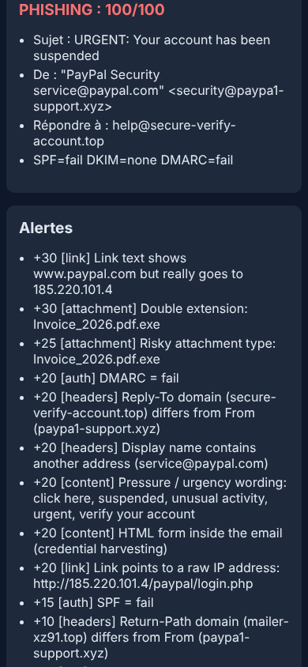

# phishlens: web interface, AI and mailbox connector

Runs on a Debian or Ubuntu server (Python 3.10+), on premises or in a VPC.
The web interface is currently in French.



## Install

```bash
sudo apt install git
git clone https://github.com/aelof1/phishlens.git
cd phishlens
sudo ./deploy/install.sh
```

Then follow the steps printed at the end. If you see the default Apache page:
`sudo a2dissite 000-default && sudo systemctl reload apache2`.

## Connect a mailbox

Fill in `/etc/phishlens/mail.env`, then test:

```bash
sudo systemctl start phishlens-scan
journalctl -u phishlens-scan -n 20
```

- Gmail: `imap.gmail.com` with an app password (2-Step Verification required).
- Microsoft 365: not supported, because it requires OAuth.
- Other servers: IMAP over TLS (port 993).

## Local AI (optional)

Install [Ollama](https://ollama.com/download), then run `ollama pull llama3.1`.
Uncomment the `PHISHLENS_AI_URL` line in `/etc/phishlens/ai.env`, then run
`sudo systemctl restart apache2`. Without a GPU, answers can be slow.

The AI opinion is advisory: a malicious email can try to manipulate it. The score comes from the rules only.

## Network and security

- Inbound: 443 (and 80 for Let's Encrypt), limited to your network or VPN. Public exposure is not recommended.
- Outbound: 993 to the mail server, plus the AI API if it is remote.
- HTTPS: `sudo apt install certbot python3-certbot-apache && sudo certbot --apache -d your-domain.com`
  (needs a public domain name; otherwise use a certificate from your internal authority).
- Without HTTPS, the password travels in clear text.
- The database keeps subject, sender, findings and AI opinion, not message bodies.

Troubleshooting: `sudo tail /var/log/apache2/phishlens_error.log`
